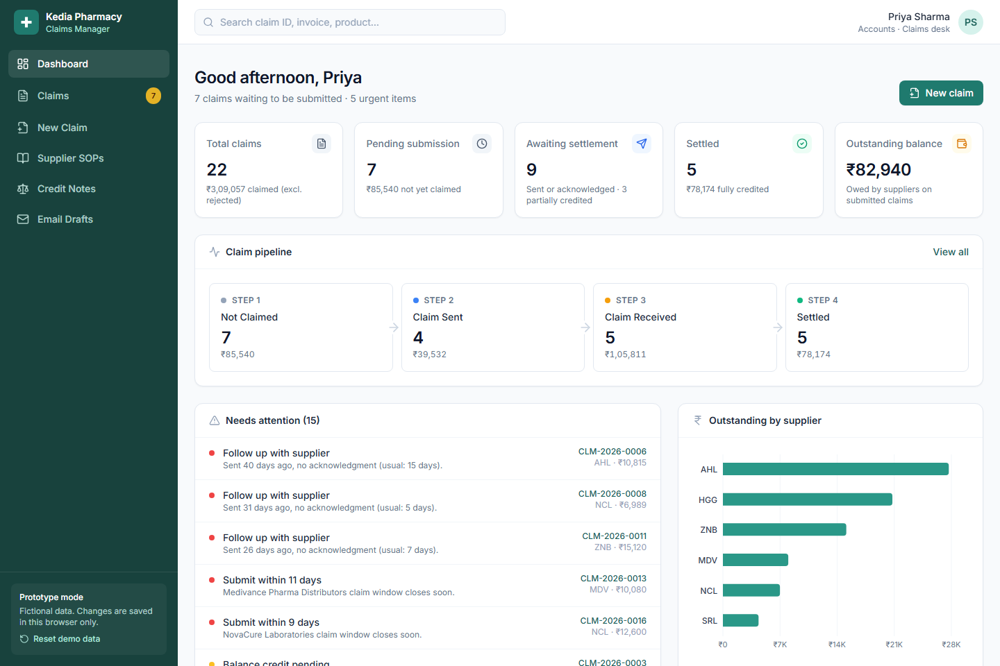
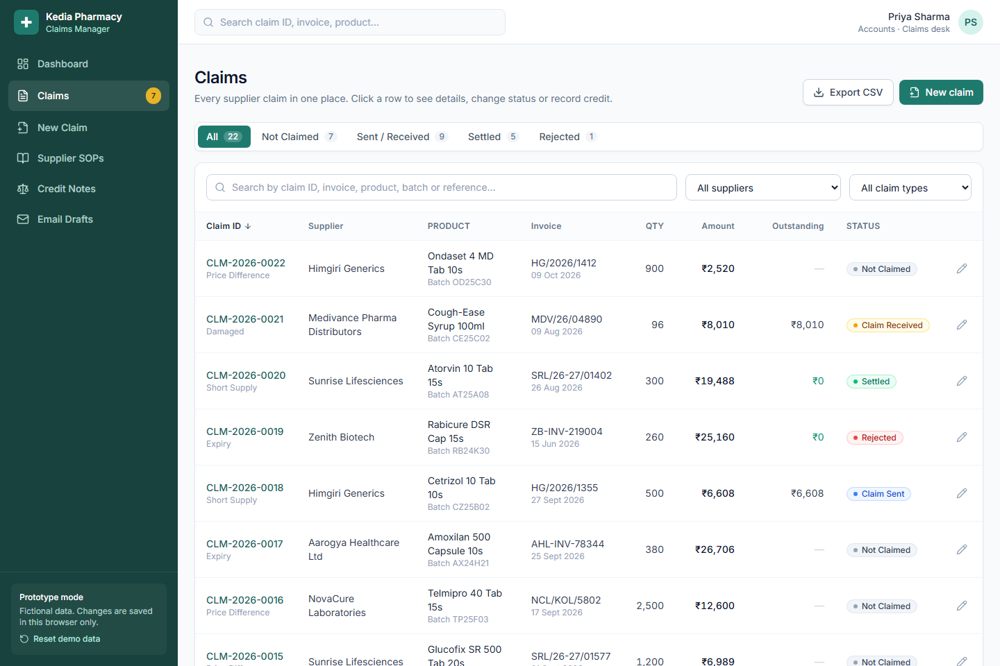
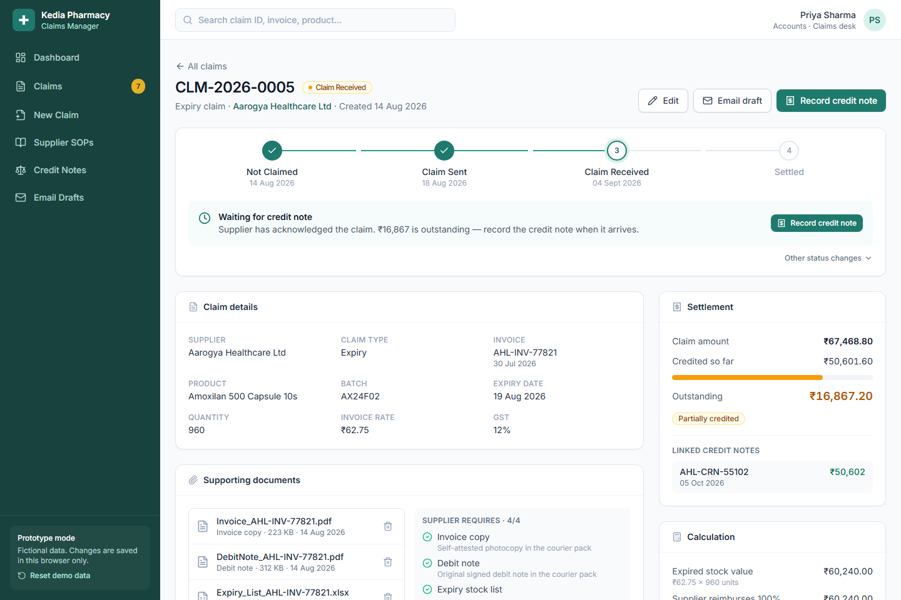
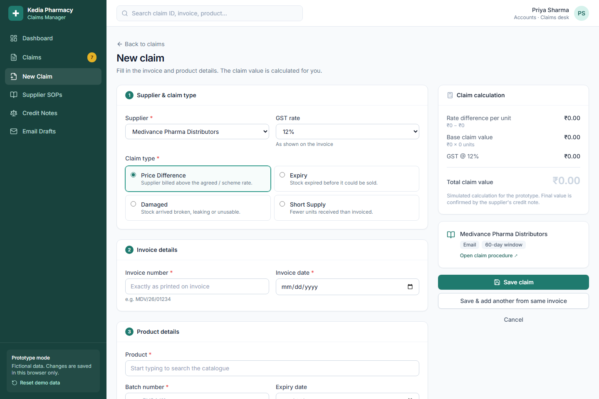
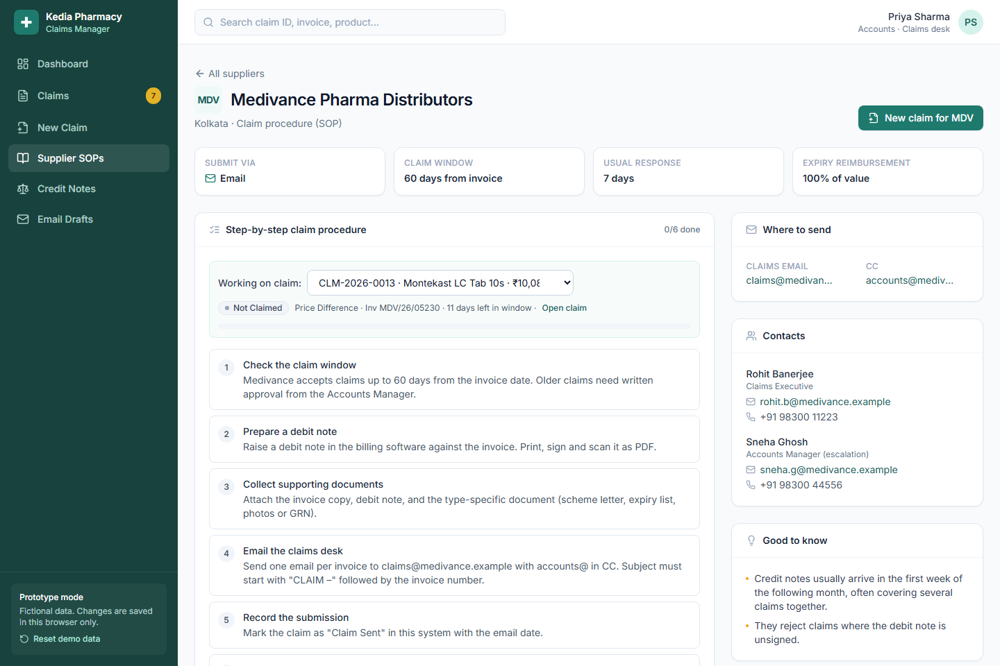
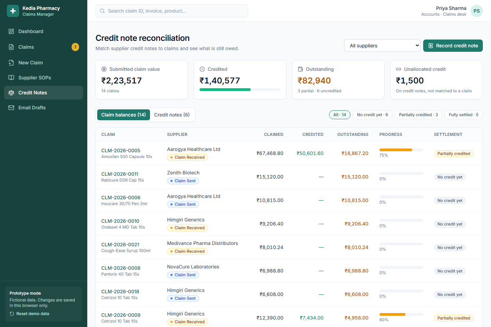
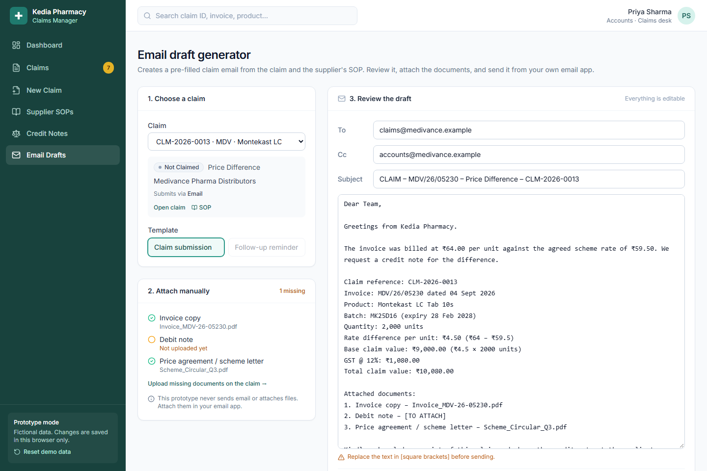

# Kedia Pharmacy – Claims Manager

A clickable, frontend-only prototype that replaces the spreadsheets, email threads and staff memory Kedia Pharmacy uses today to claim money back from suppliers. It covers price-difference, expiry, damaged-stock and short-supply claims, and matches supplier credit notes against them.

The prototype is built for **non-technical staff**. Every screen shows where a claim is and what to do next, and the supplier's own rules (claim window, documents, email format) appear at the point where they're needed.

> **Prototype only.** All suppliers, people, products, emails and phone numbers are fictional. There is no backend, login or real email sending. Changes are saved in your browser.

- **Live demo:**https://kediawork.vercel.app/
- **Wireframes:** https://kinghardesh.github.io/kediawork/wireframes.html (source: [`public/wireframes.html`](public/wireframes.html))

---

## Quick start

Requires **Node.js 18+** and npm.

```bash
npm install
npm run dev        # http://localhost:5173
```

| Command | What it does |
|---|---|
| `npm run dev` | Start the dev server with hot reload |
| `npm run build` | Type-check and build static files into `dist/` |
| `npm run preview` | Serve the production build locally |

The build is plain static files: it uses a relative base path and hash-based URLs, so `dist/` works on any static host (GitHub Pages, Netlify, Vercel) with no server setup.

**Deployment:** [`.github/workflows/deploy.yml`](.github/workflows/deploy.yml) builds the app and publishes it to GitHub Pages on every push to `main`. One-time setup: **Settings → Pages → Source: GitHub Actions**.

**Reset the demo:** click **Reset demo data** at the bottom of the sidebar to restore the original sample data.

### Sample data worth opening

The sample data includes every settlement state, so you can see them without creating anything:

| State | Example claims | What to look at |
|---|---|---|
| **Fully settled** | CLM-2026-0001, CLM-2026-0002 | Both were paid by **one** credit note (MDV-CN-2026-0412). Outstanding is ₹0 and the status is *Settled*. |
| **Partially credited** | CLM-2026-0003 (50%), CLM-2026-0009 (60%), CLM-2026-0005 (75%) | The amber *Partially credited* label in the Claims table, plus the progress bar, credit note and remaining balance on the claim page. |
| **Unallocated credit** | AHL-CRN-55102 | ₹1,500 on this credit note isn't matched to any claim. Use **Credit Notes → Credit notes → Allocate** to match it. |
| **Rejected** | CLM-2026-0019 | Submitted after the supplier's claim window, with the rejection reason recorded. |
| **Needs follow-up** | CLM-2026-0006, CLM-2026-0011 | Sent but not acknowledged within the supplier's usual time. These appear on the dashboard alerts. |

On **Credit Notes → Claim balances**, the *Partially credited* and *Fully settled* filters list each group.

---

## The five demo workflows

These are the interactions the prototype is built around. Each one can be done end to end in the browser.

### 1. Create a claim and see it in the claims table
1. Click **New claim** (sidebar or dashboard).
2. Pick a supplier and claim type. Types the supplier doesn't accept are greyed out.
3. Enter the invoice and product details. The **claim calculation** panel updates as you type, and a warning appears if the invoice is close to (or past) the supplier's claim window.
4. Drop in supporting documents. Each file's document type is guessed from its name, and a checklist shows which of the supplier's required documents are still missing.
5. Click **Save claim**. The claim opens, and it appears at the top of **Claims** as *Not Claimed*.

### 2. Move a claim from Not Claimed → Claim Sent → Claim Received
1. Open a claim. The status tracker and a **Next step** card show what to do.
2. Click **Mark as sent** and enter the date, method and reference (portal reference or courier docket). If required documents are missing, the dialog warns you.
3. Click **Mark as received** when the supplier acknowledges.
4. Every change is written to the claim's **History** with who made it and when.

### 3. Open a supplier's SOP and follow it
1. From a claim, click **Follow SOP** (or go to **Supplier SOPs**).
2. The procedure opens with your claim already selected. Tick each step as you go; a progress bar fills up.
3. Shortcuts at the bottom take you straight to **Generate email** and **Mark as sent**.

### 4. Generate an email draft for a claim
1. From a claim or the SOP, click **Generate email** (or open **Email Drafts** and choose a claim).
2. To, CC, subject and body are filled in from the claim and the supplier's SOP, including the supplier's subject-line format, the claim calculation and the list of documents to attach.
3. Use **Copy email** or **Open in email app**, attach the files yourself, and send.
4. Click **I've sent it – mark as sent** to record the submission.
5. For overdue claims, switch to the **Follow-up reminder** template. The dashboard's *Follow up with supplier* alerts open it directly.

### 5. Record a credit note and update the outstanding balance
1. Go to **Credit Notes** → **Record credit note** (or use the button on a submitted claim).
2. Enter the credit note number, date and amount, then split it across the supplier's open claims. You can type amounts or use **Auto-allocate oldest first**.
3. On save, outstanding balances update immediately:
   - a claim that is fully covered becomes **Settled** automatically;
   - a partial credit shows as *Partially credited*, with the remaining balance;
   - any amount not matched to a claim stays on the credit note as *unallocated* and can be matched later with **Allocate**.

---

## Screenshots

| | |
|---|---|
| **Dashboard**: KPIs, claim pipeline, alerts, outstanding balance by supplier<br> | **Claims**: search, filters, status tabs, outstanding balances<br> |
| **Claim detail**: a partially credited claim, with status tracker, next step and settlement<br> | **New claim**: live calculation and the supplier's SOP hints<br> |
| **Supplier SOP**: step-by-step checklist linked to a claim<br> | **Credit notes**: claimed vs credited vs outstanding<br> |
| **Email draft**: pre-filled from the claim and SOP, with attachment checklist<br> | |

---

## Modules

| Module | What it does |
|---|---|
| **Dashboard** | KPIs (total claims, pending submission, awaiting settlement, settled, outstanding balance), a clickable claim pipeline, *Needs attention* alerts, outstanding balance by supplier, and recent activity. |
| **Claims** | A searchable, filterable and sortable table with status tabs, totals and CSV export. On phones it switches to a card list. |
| **New / Edit claim** | A five-section form with a live claim calculation, claim-window warnings, the supplier's document checklist and drag-and-drop uploads. Edits are recorded in the claim's history. |
| **Claim detail & history** | A status tracker with a next-step card, claim details, documents, the calculation, settlement progress, linked credit notes, submission details, the full history and notes. |
| **Supplier SOPs** | One page per supplier: submission method, claim window, required documents for each claim type, contacts, tips, and a step-by-step procedure you can tick off against a specific claim. |
| **Credit notes** | Records credit notes and splits them across claims. Shows totals for claimed, credited, outstanding and unallocated amounts, with filters for *no credit*, *partially credited* and *fully settled*. |
| **Email drafts** | A pre-filled submission or follow-up email, an attachment checklist, copy and open-in-email-app buttons, and a mark-as-sent shortcut. |

---

## Business rules used in the prototype

**Claim statuses**

`Not Claimed → Claim Sent → Claim Received → Settled`, plus `Rejected`.
- *Settled* is set automatically when credit notes cover the full claim amount (within ₹0.50). A partial credit moves a sent claim to *Claim Received*.
- Staff can also change a status manually from **Other status changes**. Rejecting, reopening or manually settling a claim requires a reason.

**Claim calculation** (simulated)

| Type | Base value |
|---|---|
| Price difference | (invoice rate − agreed rate) × quantity |
| Expiry | invoice rate × quantity × the supplier's reimbursement % |
| Damaged / short supply | invoice rate × quantity |

GST at the invoice rate is added on top of the base value.

**Needs-attention alerts**
- The claim window is closing (15 days or fewer left) or has passed.
- A required document is missing on an unsubmitted claim.
- A sent claim hasn't been acknowledged within the supplier's usual response time.
- An acknowledged claim still has a balance outstanding more than 30 days later.

**Outstanding balance** counts submitted claims only (sent, received or settled), minus the credit notes allocated to them. Unsubmitted claims are shown separately as *pending submission*.

---

## Tech stack

- **React 18 + TypeScript + Vite**: UI, type safety and a fast dev server
- **Tailwind CSS**: one set of shared styles, responsive layouts
- **React Router (hash routing)**: deep links that work on any static host
- **Lucide React**: icons
- **Recharts**: dashboard chart (loaded only with the dashboard)
- **Browser localStorage**: keeps your demo changes between visits

## Project structure

```
src/
  main.tsx              routes (pages load on demand)
  types.ts              data model: Claim, Supplier, CreditNote…
  data/
    suppliers.ts        6 fictional suppliers with their SOPs
    mock.ts             22 sample claims and 6 credit notes, dated relative to today
  store/store.tsx       app state, all actions, localStorage persistence
  lib/
    calc.ts             claim calculation, balances, attention rules
    email.ts            email draft builder
    format.ts           ₹ and date formatting
  components/           layout, UI kit, dialogs, document upload
  pages/                one file per screen
public/wireframes.html  low-fidelity wireframes for all 7 modules
docs/                   assignment notes
```

---

## Assumptions

- One claim covers one product batch on one invoice. Several lines from the same invoice are entered with **Save & add another**.
- Claim amounts are calculated before GST, and GST is then added at the invoice rate. The supplier's credit note is treated as the final amount.
- One credit note can pay several claims, and one claim can be paid by several credit notes.
- Each supplier has a single SOP covering all claim types, with documents that vary by type.
- Single user (Priya Sharma, Accounts). The names in the history are sample data.
- Dates in the sample data are generated relative to today, so the alerts always look current.

## Limitations of this prototype

- **No backend:** data lives in one browser's localStorage. It isn't shared between users or devices, and clearing site data erases it.
- **Documents:** only file names and sizes are stored, not the files themselves.
- **No real email:** the app builds the draft and hands it to your email app (`mailto:`). Attachments are added by hand.
- **No sign-in, roles or approvals.** Anyone with the link can change anything.
- **Simulated calculation:** it doesn't handle schemes with free goods, trade discounts, slab pricing or GST split rules.
- **Fictional supplier portals:** portal submission is simulated by entering a reference number.
- **Not tested** with screen readers in depth, or at production data volumes (thousands of claims).

## Requirements for a production system

1. **Backend and database** (e.g. PostgreSQL) with an API, plus regular backups and a full audit trail.
2. **Sign-in and roles**: Accounts staff, a manager who approves write-offs, and read-only access for owners. Single sign-on with the company email if available.
3. **Document storage**: secure file storage (e.g. S3) with virus scanning, previews and a retention policy.
4. **Email integration**: send from a shared claims mailbox (Microsoft 365 / Gmail API), track replies, and log sent emails against the claim.
5. **Data import**: pull invoices and products from the billing or ERP system instead of typing them in, and import supplier schemes and rate agreements.
6. **SOPs managed by admins**: an editor for supplier procedures, windows and required documents, keeping old versions.
7. **Reconciliation**: import credit notes from statements or accounting software, suggest matches automatically, and flag differences.
8. **Notifications**: reminders by email or WhatsApp for closing windows and overdue follow-ups, plus a daily digest.
9. **Reports**: recovery rate by supplier, ageing of outstanding balances, rejected-claim reasons, Excel/PDF export.
10. **Quality**: automated tests for the calculation and reconciliation rules, accessibility review, monitoring and error tracking.

---

## Delivery plan

| Day | Deliverable | Status |
|---|---|---|
| 1 | Participation confirmation; wireframes for Dashboard, Claims table, New claim | Done |
| 2 | Wireframes for the remaining modules; clickable interface started | Done |
| 3 | All screens with realistic fictional data; main interactions connected | Done |
| 4 | UI polish; five demo workflows tested | Done |
| 5 | Final checks, screenshots, GitHub Pages deployment, handover | Done |
